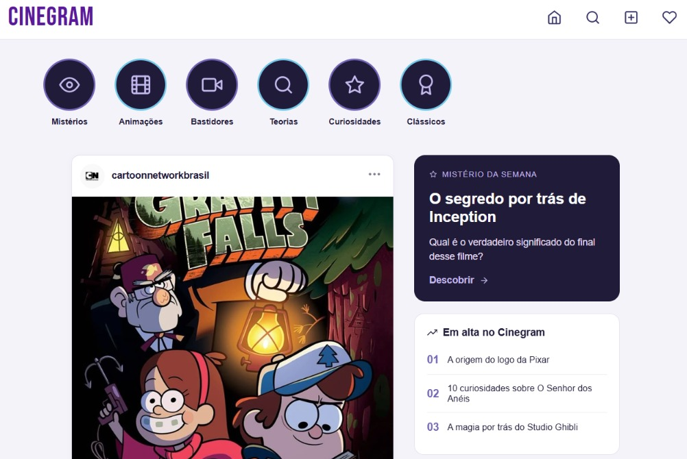
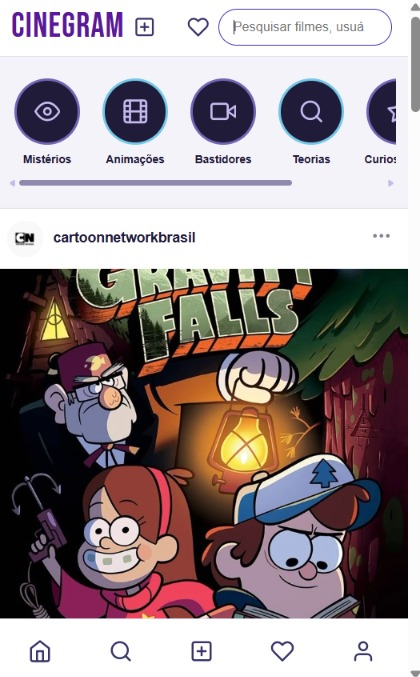

# espelho-espelho-meu
Cinegram é uma rede social inspirada no Instagram, dedicada ao universo cinematográfico. Desenvolvida com React, a plataforma reúne publicações sobre filmes, animações, teorias, mistérios e bastidores do cinema, em uma interface responsiva e interativa.

## Telas do projeto

### 1. Versão Desktop
Interface completa do Cinegram em telas maiores.

### 2. Versão Mobile
Interface responsiva adaptada para dispositivos móveis.

### 3. Funcionalidades de interação
Demonstração das funções de curtir e comentar publicações.

### 4. Funcionalidade de pesquisa
Ferramenta de pesquisa para encontrar publicações no Cinegram.

